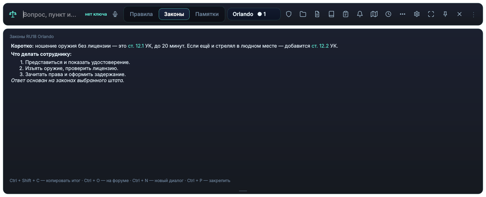
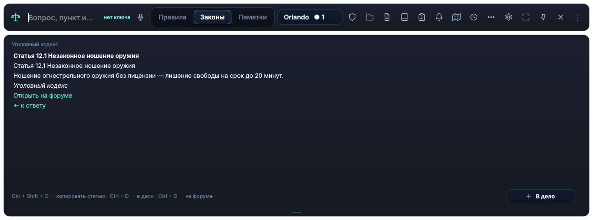
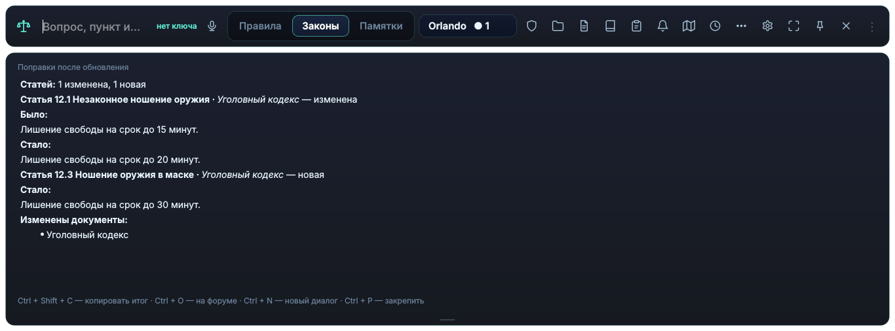
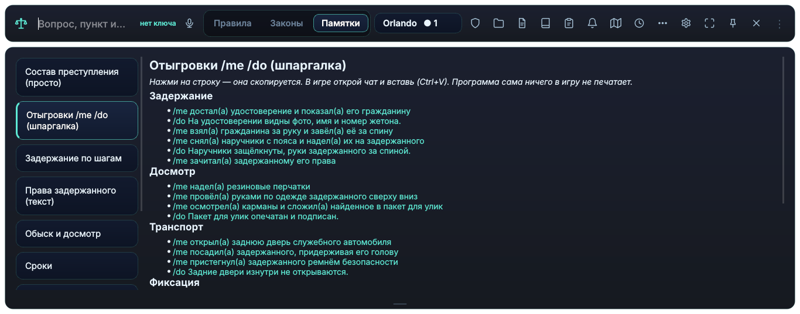
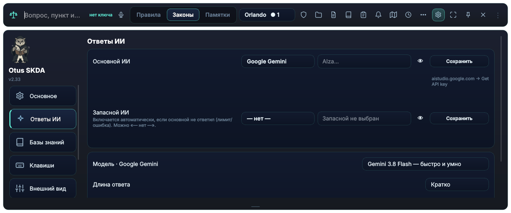

# 🦉 Otus

**ИИ-помощник по законам GTA 5 RP прямо поверх игры** — для игроков Majestic RP

### [⬇️ Скачать последнюю версию](https://github.com/funnynewguy001/Otus/releases/latest)

---

Спросил голосом или текстом — получил ответ по законам **своего штата**, не сворачивая игру.
Otus знает законы, уставы ведомств и правила проекта, даёт ссылки на статьи и помогает с документами.

## ✨ Возможности

- **Ответ по законам штата** — со ссылками на статьи. На «можно ли…» первой строкой: *Можно / Нельзя / Зависит*.
- **Голосом, прямо в игре** — по зажатой клавише. Есть распознавание речи **на компьютере, без интернета**.
- **Было → стало** — после обновления законов видно, какие именно статьи изменились.
- **Для рапорта** — «ч.1 ст. 6.1 УК» в один клик, сборка обвинения из нескольких статей.
- **Шпаргалка отыгровок** /me и /do — клик, и строка в буфере обмена.
- **Документы** с игровыми печатями — картинкой или сразу в Discord-канал ведомства.
- **Подача жалобы** на форум, **карта** штата, **памятки** по кодексам и уставам.
- **Работает в России** — GigaChat (Сбер) и GLM: бесплатно и без VPN.

<table>
<tr>
<td></td>
<td></td>
</tr>
<tr>
<td></td>
<td></td>
</tr>
</table>

## 📥 Установка

1. Открой [последнюю версию](https://github.com/funnynewguy001/Otus/releases/latest) и в разделе **Assets** скачай `Otus-Setup.exe`.
2. Запусти установщик и следуй шагам.
3. При первом запуске Otus проведёт по трём шагам: штат → ключ ИИ → база законов.

Вход по **ключу лицензии**, который выдаёт автор.

> **Windows пишет «Windows защитила ваш компьютер»?** Так бывает со всеми программами без платной
> подписи. Нажми **«Подробнее» → «Выполнить в любом случае»**.

**Обновления приходят сами:** когда выходит новая версия, Otus предложит обновиться.

## 🔒 Безопасность

- **Otus ничего не печатает в игру и не трогает её файлы.** Он только показывает окно поверх игры;
  текст ты сам вставляешь через Ctrl+V.
- **Ключи ИИ хранятся только на твоём компьютере** и отправляются только в выбранный тобой ИИ.
- **Пароль от форума программа не видит** — на форум ты входишь сам в обычном окне браузера.
- **Обновления скачиваются только отсюда**, из релизов этого репозитория, и проверяются по
  контрольной сумме перед установкой.
- Каждая версия собирается автоматически и проходит проверку всего интерфейса перед выпуском.

Антивирус ругается? Программы, собранные из Python, иногда дают ложные срабатывания.
Скачивай только со [страницы релизов](https://github.com/funnynewguy001/Otus/releases) — тогда файл настоящий.

## 🐞 Нашёл ошибку?

[Создай обращение](https://github.com/funnynewguy001/Otus/issues/new/choose) или напиши в Discord:
что нажимал, что ожидал и что произошло, и приложи скриншот. Это очень помогает.

## ❓ Частые вопросы

<b>Нужен ли платный ИИ?</b>

Нет. Бесплатного ключа Gemini хватает для обычной игры. Из России — GigaChat или GLM, тоже бесплатно.

<b>Что, если ИИ не отвечает?</b>

Если Google перегружен, Otus сам повторит запрос или ответит лёгкой моделью. Можно выбрать
**запасной ИИ** в ⚙ → Ответы ИИ — тогда Otus переключится на него автоматически.

<b>Это не нарушает правила проекта?</b>

Otus — справочник с ИИ: он не автоматизирует игру, не нажимает клавиши и не читает её память.
Все отыгровки ты вводишь сам.

<b>Какие системы поддерживаются?</b>

Windows 10 и 11, 64-бит.

---

Не является официальным продуктом Majestic RP или Rockstar Games.

